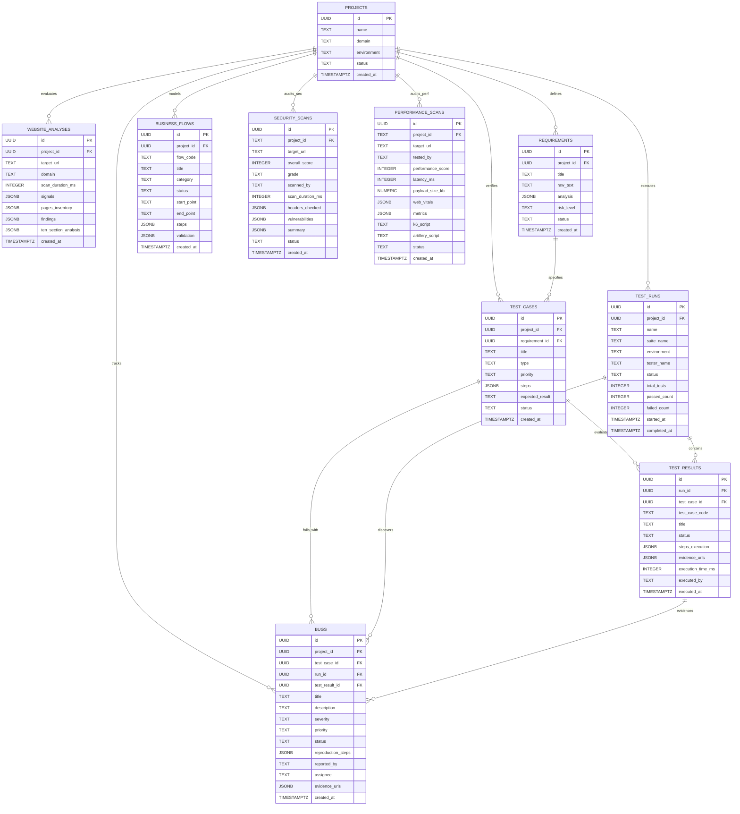
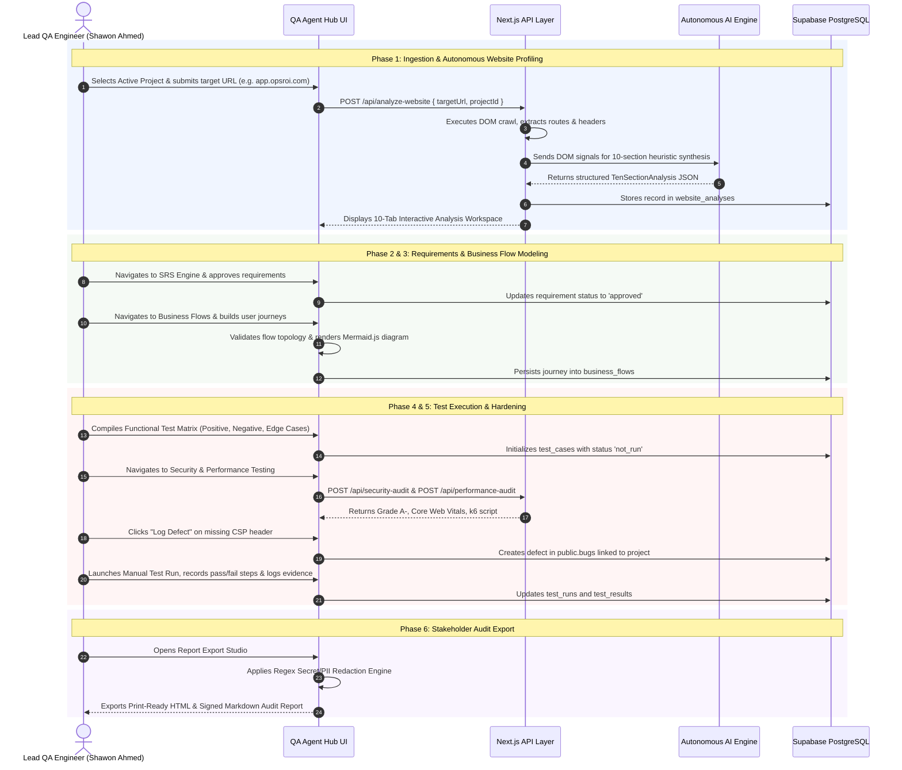

# QA Agent Hub — System Architecture, Module Breakdown & End-to-End Workflow Blueprint

**Document Version:** 10.0 (Enterprise Gold Master Release)  
**Classification:** Enterprise Technical Documentation & Architectural Blueprint  
**System Title:** QA Agent Hub — Autonomous Quality Engineering & Test Orchestration Platform  
**Target Environment:** Lead QA Architect Workspace (`d:\qa-agent-hub`)  
**Lead QA Engineer & Platform Owner:** Shawon Ahmed  
**Document Author:** Principal Solutions Architect, Enterprise Technical Writer & Lead QA Engineer  
**Date of Compilation:** October 2026  

---

## Table of Contents

1. [Executive Summary & Technical Architecture](#1-executive-summary--technical-architecture)
   - 1.1 [Platform Scope & Vision](#11-platform-scope--vision)
   - 1.2 [Workspace Hygiene & D-Drive Isolation Standards](#12-workspace-hygiene--d-drive-isolation-standards)
   - 1.3 [Core Technology Stack](#13-core-technology-stack)
   - 1.4 [High-Level System Architecture Diagram](#14-high-level-system-architecture-diagram)
2. [Complete Module Breakdown & Functional Capabilities](#2-complete-module-breakdown--functional-capabilities)
   - 2.1 [Module 1: Website Analysis Engine](#21-module-1-website-analysis-engine)
   - 2.2 [Module 2: SRS & Traceability Engine](#22-module-2-srs--traceability-engine)
   - 2.3 [Module 3: Business Flows & Visual Workflow Builder](#23-module-3-business-flows--visual-workflow-builder)
   - 2.4 [Module 4: Functional QA & Test Matrix](#24-module-4-functional-qa--test-matrix)
   - 2.5 [Module 5: AI Prompt Generator Workspace](#25-module-5-ai-prompt-generator-workspace)
   - 2.6 [Module 6: Professional Report Export System](#26-module-6-professional-report-export-system)
   - 2.7 [Module 7: Test Management & Manual QA Execution](#27-module-7-test-management--manual-qa-execution)
   - 2.8 [Module 8: Defect Management & Bug Tracking](#28-module-8-defect-management--bug-tracking)
   - 2.9 [Module 9: API Testing & Playwright Automation](#29-module-9-api-testing--playwright-automation)
   - 2.10 [Module 10: Security & Performance Testing](#210-module-10-security--performance-testing)
3. [Database Schema & Cross-Module Traceability](#3-database-schema--cross-module-traceability)
   - 3.1 [Entity Relationship Diagram (ERD)](#31-entity-relationship-diagram-erd)
   - 3.2 [Comprehensive PostgreSQL Table Definitions](#32-comprehensive-postgresql-table-definitions)
   - 3.3 [The 5-State Verification Tagging Architecture](#33-the-5-state-verification-tagging-architecture)
4. [End-to-End QA Workflow Journey](#4-end-to-end-qa-workflow-journey)
   - 4.1 [Phase 1: Ingestion & Autonomous Website Profiling](#41-phase-1-ingestion--autonomous-website-profiling)
   - 4.2 [Phase 2: Requirements Extraction & SRS Generation](#42-phase-2-requirements-extraction--srs-generation)
   - 4.3 [Phase 3: Business Flow Synthesis & Topology Validation](#43-phase-3-business-flow-synthesis--topology-validation)
   - 4.4 [Phase 4: Test Matrix Design & Automation Scripting](#44-phase-4-test-matrix-design--automation-scripting)
   - 4.5 [Phase 5: Manual Execution, Defect Triaging & Security Auditing](#45-phase-5-manual-execution-defect-triaging--security-auditing)
   - 4.6 [Phase 6: Stakeholder Audit Export & Sign-Off](#46-phase-6-stakeholder-audit-export--sign-off)
5. [Operational Guidelines & Best Practices](#5-operational-guidelines--best-practices)

---

# 1. Executive Summary & Technical Architecture

### 1.1 Platform Scope & Vision

**QA Agent Hub** is an enterprise-grade autonomous quality assurance and test management platform engineered specifically for **Shawon Ahmed** (Lead QA Engineer). Modern web software delivery cycles demand rapid verification across functional, exploratory, security, performance, accessibility, and integration vectors. Traditional test management tools remain fragmented—maintaining disconnected requirements trackers, separate test case tables, standalone bug trackers, and unintegrated load/security scripts.

QA Agent Hub bridges this chasm by delivering an **all-in-one autonomous quality engineering operating system**. It ingests target web applications, executes autonomous heuristic DOM analysis, extracts business intelligence, auto-generates Software Requirements Specifications (SRS) with Gherkin acceptance criteria, models end-to-end user journeys into Mermaid.js workflow diagrams, compiles complete test matrices, facilitates manual test run logging with evidence, manages defect lifecycles, and automates Playwright, API, OWASP security, and k6/Artillery load testing suites.

### 1.2 Workspace Hygiene & D-Drive Isolation Standards

To maintain deterministic build pipelines and guarantee enterprise-grade isolation, QA Agent Hub adheres strictly to workspace hygiene standards:

- **Isolated D-Drive Root**: All application code, configuration files, static assets, migrations, and local dependencies reside exclusively within `d:\qa-agent-hub`.
- **Absolute Path Protection**: No file system leaks, temporary artifacts, or operational scripts are written outside `d:\qa-agent-hub`. Node modules, caches, and build outputs are strictly quarantined.
- **Single Source of Truth**: Data models, navigation states, active project context, and mock fallbacks are managed through unified TypeScript contracts in `types/` and persisted through Supabase PostgreSQL schemas in `supabase/migrations/`.
- **Zero-Tolerance Quality Gates**: All source files maintain 100% strict TypeScript compliance (`tsc --noEmit` exit code 0) and clean Next.js server/client component boundaries without hydration mismatches or lint warnings.

### 1.3 Core Technology Stack

QA Agent Hub utilizes a curated, bleeding-edge full-stack architecture optimized for high-throughput UI updates, real-time telemetry, and resilient cloud integration:

| Layer | Technology | Architectural Role & Implementation Details |
| :--- | :--- | :--- |
| **Frontend Framework** | **Next.js 15 (App Router)** | Modern React Server Components (RSC) paired with selective Client Components (`"use client"`). Utilizes server actions, route handlers, and Turbopack dev tooling for sub-second hot reloading. |
| **Programming Language** | **TypeScript 5.x** | Strict mode enabled (`strict: true`). Zero implicit `any`. Fully typed database mappings, API request/response payloads, and UI component interfaces. |
| **Styling & Design System** | **Tailwind CSS & Vanilla CSS** | Enterprise Navy/Indigo theme (`#0F172A`, `#1E293B`, `#4F46E5`, `#6366F1`) augmented with clean slate backgrounds (`#F8FAFC`), glassmorphism, responsive CSS grid layouts, and micro-animations. |
| **Iconography & Visuals** | **Lucide React** | Clean, accessible SVG iconography representing QA domains, severity tiers, system statuses, and interactive workflow diagrams. |
| **Relational Database** | **Supabase (PostgreSQL 15+)** | Managed PostgreSQL database providing strong relational integrity, foreign key cascading, index optimization, and flexible `JSONB` document storage for complex test executions and crawl trees. |
| **Autonomous AI Engine** | **Google Gemini API (1.5 Pro / Flash)** | High-context autonomous intelligence engine driving website feature extraction, heuristic UX analysis, Gherkin scenario generation, and specialized QA prompt synthesis. |
| **E2E Automation** | **Playwright (TypeScript)** | Industry-standard browser automation integration producing modular test specs structured with Page Object Models (POM), robust locator strategies (`getByRole`, `getByTestId`), and trace visualizer telemetry. |
| **API & Load Testing** | **Native Fetch, k6 & Artillery** | Native server-side fetch runner for HTTP assertion testing; 1-click generators for k6 ES6 scripts and Artillery YAML scenarios with built-in SLA percentile thresholds. |

---

### 1.4 High-Level System Architecture Diagram

```mermaid
flowchart TB
    subgraph Client_Layer ["Client Presentation Layer (Next.js 15 App Router)"]
        UI_Shell["Dashboard Shell & Layout\n(Collapsible Navy Sidebar, Header, Profile Dropdown)"]
        Module_Web["Module 1: Website Analysis"]
        Module_SRS["Module 2: SRS & Traceability"]
        Module_Flows["Module 3: Business Flows"]
        Module_TestMatrix["Module 4: Functional QA Matrix"]
        Module_Prompts["Module 5: AI Prompt Generator"]
        Module_Reports["Module 6: Report Export System"]
        Module_ManualQA["Module 7: Manual QA Execution"]
        Module_Defects["Module 8: Defect Management"]
        Module_Automation["Module 9: Playwright & API Testing"]
        Module_SecPerf["Module 10: Security & Performance"]
    end

    subgraph Service_Layer ["Server & API Service Layer (Next.js API Routes)"]
        API_WebScan["/api/analyze-website\n(DOM Crawler & Heuristic Evaluator)"]
        API_SRS["/api/analyze-requirement\n(Gherkin SRS Transformer)"]
        API_APIRunner["/api/api-test-runner\n(HTTP/REST Execution & Assertion Engine)"]
        API_SecScan["/api/security-audit\n(OWASP Header & Vulnerability Inspector)"]
        API_PerfAudit["/api/performance-audit\n(Latency, TTFB & Core Web Vitals Calculator)"]
    end

    subgraph Intelligence_Layer ["Autonomous AI & Testing Engines"]
        Gemini_AI["Google Gemini 1.5 Pro / Flash\n(Structured JSON Extraction & Prompt Synthesis)"]
        Playwright_Engine["Playwright Test Engine\n(Page Object Models & Trace Telemetry)"]
        Load_Engine["k6 & Artillery Load Generator\n(SLA Threshold Verification)"]
    end

    subgraph Storage_Layer ["Persistence & Governance (Supabase PostgreSQL)"]
        DB_Projects[(projects)]
        DB_Analyses[(website_analyses)]
        DB_Reqs[(requirements)]
        DB_Flows[(business_flows)]
        DB_TestCases[(test_cases)]
        DB_TestRuns[(test_runs & test_results)]
        DB_Bugs[(bugs)]
        DB_SecPerf[(security_scans & performance_scans)]
    end

    UI_Shell --> Module_Web & Module_SRS & Module_Flows & Module_TestMatrix & Module_Prompts
    UI_Shell --> Module_Reports & Module_ManualQA & Module_Defects & Module_Automation & Module_SecPerf

    Module_Web --> API_WebScan
    Module_SRS --> API_SRS
    Module_Automation --> API_APIRunner
    Module_SecPerf --> API_SecScan & API_PerfAudit

    API_WebScan & API_SRS --> Gemini_AI
    Module_Automation --> Playwright_Engine
    Module_SecPerf --> Load_Engine

    API_WebScan --> DB_Analyses
    API_SRS --> DB_Reqs
    Module_Flows --> DB_Flows
    Module_TestMatrix --> DB_TestCases
    Module_ManualQA --> DB_TestRuns
    Module_Defects --> DB_Bugs
    API_SecScan & API_PerfAudit --> DB_SecPerf
    DB_Projects -.-> DB_Analyses & DB_Reqs & DB_Flows & DB_TestCases & DB_Bugs & DB_SecPerf
```



---

# 2. Complete Module Breakdown & Functional Capabilities

QA Agent Hub delivers 10 tightly coupled yet modular functional workspaces, providing comprehensive coverage across the entire software testing lifecycle.

---

### 2.1 Module 1: Website Analysis Engine
**Primary Route:** `/website-analysis`  
**Core Components:** [`components/website-analysis/WebsiteAnalysisModule.tsx`](file:///d:/qa-agent-hub/components/website-analysis/WebsiteAnalysisModule.tsx), [`components/website-analysis/TenSectionAnalysisViewer.tsx`](file:///d:/qa-agent-hub/components/website-analysis/TenSectionAnalysisViewer.tsx)  
**API Handler:** [`app/api/analyze-website/route.ts`](file:///d:/qa-agent-hub/app/api/analyze-website/route.ts)  

The Website Analysis Engine executes deep autonomous reconnaissance on any target web application. Rather than offering basic surface-level scraping, it combines raw HTML DOM crawling with AI heuristic synthesis.

#### Key Capabilities:
1. **Dynamic Business Category Detection**: Automatically categorizes applications into specialized domain models:
   - *E-Commerce & Retail* (e.g., Daraz Bangladesh, Shopify storefronts): Evaluates product catalogs, cart state management, checkout funnels, payment gateways, and order tracking.
   - *B2B SaaS & Cloud Platforms* (e.g., OpsROI Cloud, Jira, Datadog): Evaluates multi-tenancy, RBAC roles, subscription tiers, API integrations, and team workspaces.
   - *FinTech & Payment Gateways*: Evaluates transaction security, KYC verification steps, ledger accuracy, and PCI-DSS compliance indicators.
   - *Content, Media & Portals*: Evaluates SEO metadata, content hierarchies, search responsiveness, and digital asset rendering.
2. **Anti-Fabrication Safeguards**:
   - The crawler enforces strict truthfulness rules. Information not explicitly found in public DOM structures (such as internal private revenue models or proprietary backend databases) is flagged as `"Not publicly available"` or `"Not disclosed"` rather than hallucinated.
   - Unverified hypotheses are tagged with the verification status `Unverified` or `AI Generated`.
3. **Heuristic UX Usability Scoring (0–100)**:
   - A mathematical model analyzes visual clutter, DOM depth, missing alt tags, contrast ratios, viewport adaptability, and interaction friction.
4. **10-Section Exhaustive Analysis Workspace**:
   - **Tab 1: Crawling & Data Collection**: Discovered route inventory, HTTP status codes, load latencies, size in KB, and site navigation depth.
   - **Tab 2: Business Overview**: Problem statement solved, core products/services, unique value proposition, and verified monetization strategy.
   - **Tab 3: Target Audience & Personas**: Primary and secondary user personas with explicit goals, technical proficiency tiers, and friction points.
   - **Tab 4: Features & Workflows**: Inventory of major functional features mapped to business benefits and user journeys.
   - **Tab 5: Competitor Analysis**: Direct and indirect industry competitors, market differentiators, and feature parity deficits.
   - **Tab 6: Missing Features & Gaps**: Critical user expectation gaps, workflow bottlenecks, and market expansion opportunities.
   - **Tab 7: Business Opportunities**: Actionable automation, growth, and monetization vectors graded by effort vs. return.
   - **Tab 8: UI/UX Experience**: Usability index score, mobile responsiveness audit, friction breakdown, and layout recommendations.
   - **Tab 9: Business Risks & Limitations**: Operational, scalability, workflow, and compliance risks paired with risk mitigation strategies.
   - **Tab 10: Final Report & Recommendations**: Synthesized executive summary with high-, medium-, and low-priority tactical QA initiatives.

---

### 2.2 Module 2: SRS & Traceability Engine
**Primary Route:** `/requirements`  
**Core Components:** [`components/requirements/RequirementsModule.tsx`](file:///d:/qa-agent-hub/components/requirements/RequirementsModule.tsx), [`components/requirements/SRSViewerModal.tsx`](file:///d:/qa-agent-hub/components/requirements/SRSViewerModal.tsx)  
**API Handler:** [`app/api/analyze-requirement/route.ts`](file:///d:/qa-agent-hub/app/api/analyze-requirement/route.ts)  

The SRS (Software Requirements Specification) & Traceability Engine transforms ambiguous stakeholder briefs, product descriptions, or raw feature notes into IEEE-830 aligned requirements documentation.

#### Key Capabilities:
1. **Automated Gherkin Acceptance Criteria**:
   - Every requirement is broken down into standard Behavior-Driven Development (BDD) scenarios utilizing strict `Given [precondition] When [action] Then [expected outcome]` syntax.
2. **Requirements Risk Stratification**:
   - Classifies requirements into four risk tiers (`Critical`, `High`, `Medium`, `Low`) based on business criticality, security exposure, and architectural complexity.
3. **Lifecycle Approval Workflow**:
   - Tracks requirement maturity across states: `Draft` $\rightarrow$ `Analyzed` $\rightarrow$ `Approved` $\rightarrow$ `Archived`.
   - Only `Approved` requirements can be automatically converted into downstream test cases.
4. **Two-Way Supabase Synchronization**:
   - Persists all requirements directly to `public.requirements` with foreign-key relationships to `public.projects`, ensuring end-to-end traceability when defects are subsequently reported.

---

### 2.3 Module 3: Business Flows & Visual Workflow Builder
**Primary Route:** `/business-flows`  
**Core Components:** [`components/business-flows/BusinessFlowsWorkspace.tsx`](file:///d:/qa-agent-hub/components/business-flows/BusinessFlowsWorkspace.tsx), [`components/business-flows/MermaidFlowViewer.tsx`](file:///d:/qa-agent-hub/components/business-flows/MermaidFlowViewer.tsx)  

The Business Flows workspace models user journeys, business logic branches, and end-to-end transaction topologies.

#### Key Capabilities:
1. **Step-by-Step Topology Mapping**:
   - Every flow defines an exact `start_point`, sequential execution steps (Action $\rightarrow$ System Validation $\rightarrow$ State Change), decision bifurcations (e.g., *Valid Credentials* vs. *Account Locked*), and `end_point`.
2. **QA Health Audit Algorithm**:
   - Evaluates workflow graphs for orphan steps, broken exit paths, missing validation states, and unhandled failure modes.
3. **Mermaid.js Visual Graph Engine**:
   - Auto-generates clean, responsive Mermaid.js state and flowchart diagrams rendered natively in the browser with dark/light theme awareness.
4. **Export Capabilities**:
   - 1-click export of flow definitions to Mermaid syntax, formatted Markdown documentation, and standalone JSON for pipeline consumption.

---

### 2.4 Module 4: Functional QA & Test Matrix
**Primary Route:** `/functional-qa` (and `/test-cases`)  
**Core Components:** [`components/functional-qa/FunctionalQaWorkspace.tsx`](file:///d:/qa-agent-hub/components/functional-qa/FunctionalQaWorkspace.tsx), [`lib/functional-qa/testCaseEngine.ts`](file:///d:/qa-agent-hub/lib/functional-qa/testCaseEngine.ts)  

The Functional QA module provides a comprehensive testing matrix spanning all functional, boundary, integration, and UI acceptance criteria.

#### Key Capabilities:
1. **Strict 'Not Run' Default Status Guarantee**:
   - Unlike naive generators that erroneously mark generated test cases as "Passed", QA Agent Hub strictly enforces a `not_run` default status. Tests require explicit human or automation execution before status mutation.
2. **1-Click Test Variations Engine**:
   - Automatically derives three distinct test case variants for any functional feature:
     - **Positive Tests (Happy Path)**: Validates canonical execution flows with expected valid inputs.
     - **Negative Tests (Error Path)**: Validates invalid inputs, expired tokens, empty fields, and unauthorized states.
     - **Edge Case Tests (Boundary & Concurrency)**: Validates maximum boundary characters, network latency dropouts, duplicate clicks, and race conditions.
3. **Six Canonical QA Test Types**:
   - Categorizes every test case under strict enum types: `e2e`, `api`, `unit`, `security`, `performance`, or `manual`.

---

### 2.5 Module 5: AI Prompt Generator Workspace
**Primary Route:** Accessible via `/ai-integrations` or Dashboard Launchpad  
**Core Components:** [`components/ai-prompt/AiPromptWorkspace.tsx`](file:///d:/qa-agent-hub/components/ai-prompt/AiPromptWorkspace.tsx)  
**Data Contracts:** [`types/ai-prompt.ts`](file:///d:/qa-agent-hub/types/ai-prompt.ts)  

The AI Prompt Generator is an expert prompt-engineering studio specifically tailored for QA practitioners. It synthesizes highly contextual, zero-shot/few-shot system prompts pre-loaded with project context.

#### The 12 Enterprise QA Domains:
| # | Domain ID | Domain Name | Specialized Purpose & Output Format | Recommended Model |
| :- | :--- | :--- | :--- | :--- |
| **1** | `exploratory` | **Exploratory Testing Charters** | SBTM (Session-Based Test Management) charters, heuristics, and tours. | Gemini 1.5 Pro |
| **2** | `playwright_e2e` | **E2E Playwright Automation** | Robust TypeScript specs with Page Object Models, fixtures, and locators. | Claude 3.5 Sonnet / GPT-4o |
| **3** | `api_testing` | **API Testing & Postman Collections** | REST/GraphQL contract testing, Newman collections, JSON schema tests. | Gemini 1.5 Pro |
| **4** | `security_owasp` | **Security & OWASP Top 10 Audit** | Penetration test scenarios covering XSS, SQLi, CSRF, SSRF, and Auth bypass. | Claude 3.5 Sonnet / GPT-4o |
| **5** | `performance_k6` | **Performance & Load Testing (k6)** | k6 scripts with virtual user ramps, sustained stages, and SLA thresholds. | Gemini 1.5 Pro |
| **6** | `accessibility_wcag` | **WCAG 2.1 AA Accessibility** | Aria-label validation, keyboard navigation traps, contrast and screen-reader tests. | Claude 3.5 Sonnet |
| **7** | `boundary_edge` | **Boundary Value & Equivalence** | Equivalence partitioning matrices and off-by-one boundary values. | Gemini 1.5 Pro |
| **8** | `database_integrity` | **Database & Data Integrity QA** | Foreign-key cascade validations, ACID consistency checks, and deadlocks. | GPT-4o |
| **9** | `mobile_responsive` | **Mobile Responsive & Cross-Browser** | Viewport breakpoint matrices, touch event listeners, orientation shifts. | Claude 3.5 Sonnet |
| **10**| `negative_chaos` | **Negative Testing & Chaos QA** | Fault injection, simulated 500 server crashes, corrupted payloads, timeout chaos. | Gemini 1.5 Pro |
| **11**| `compliance_audit` | **Compliance Audit (GDPR/HIPAA/SOC2)**| Data retention, cookie consent opt-outs, audit logging, and PII masking. | GPT-4o |
| **12**| `regression_architecture`| **Regression Strategy & Impact** | Selective regression suites based on code churn and risk heatmaps. | Claude 3.5 Sonnet |

---

### 2.6 Module 6: Professional Report Export System
**Primary Route:** `/qa-reports`  
**Core Components:** [`components/reports/ReportExportModal.tsx`](file:///d:/qa-agent-hub/components/reports/ReportExportModal.tsx), [`lib/reports/reportGenerator.ts`](file:///d:/qa-agent-hub/lib/reports/reportGenerator.ts)  

The Report Export System compiles holistic, stakeholder-ready documentation across all audit findings, test runs, and requirements.

#### Key Capabilities:
1. **Multi-Format Export Pipeline**:
   - **Markdown (`.md`)**: Formatted for GitHub wikis, Notion, and internal documentation repos.
   - **CSV (`.csv`)**: Normalized row data ready for import into Jira, Excel, or TestRail.
   - **JSON (`.json`)**: Raw programmatic schema exports for CI/CD pipeline gating.
   - **Print-Ready HTML (`.html`)**: Beautiful, self-contained, CSS-styled audit reports ready for PDF conversion or executive distribution.
2. **Automated Regex Secret & PII Redaction Engine**:
   - Prior to report generation, an automated regex sanitizer scans all data streams and redacts sensitive strings:
     - `bearer [a-zA-Z0-9_\-\.]{20,}` $\rightarrow$ `[REDACTED_BEARER_TOKEN]`
     - `api[_-]?key[:=]\s*["']?[a-zA-Z0-9_\-]{16,}["']?` $\rightarrow$ `[REDACTED_API_KEY]`
     - `postgres://.*:.*@.*` $\rightarrow$ `[REDACTED_DATABASE_URI]`
     - `password[:=]\s*["']?.+["']?` $\rightarrow$ `password: [REDACTED]`

---

### 2.7 Module 7: Test Management & Manual QA Execution
**Primary Route:** `/manual-qa`  
**Core Components:** [`components/manual-qa/ManualQaExecutionBoard.tsx`](file:///d:/qa-agent-hub/components/manual-qa/ManualQaExecutionBoard.tsx), [`components/manual-qa/TestExecutionModal.tsx`](file:///d:/qa-agent-hub/components/manual-qa/TestExecutionModal.tsx)  
**Database Tables:** `public.test_runs`, `public.test_results`  

The Manual QA module provides structured test cycle execution management, allowing QA engineers to launch test suites, execute step-by-step validations, record timings, and attach failure screenshots.

#### Key Capabilities:
1. **Test Run Lifecycle Management**:
   - Create and configure execution cycles specifying target suite name, environment (`Production`, `Staging`, `Dev`), and assigned tester (*Shawon Ahmed*).
   - Real-time aggregation of metrics: `total_tests`, `passed_count`, `failed_count`, `blocked_count`, `not_run_count`.
2. **Step-by-Step Test Execution Console**:
   - Testers interact with individual test cases, reviewing pre-conditions, step descriptions, and expected results.
   - Individual steps can be toggled as *Pass* or *Fail* with custom execution notes and duration tracking in milliseconds.
3. **Evidence Attachment**:
   - Captures failure screenshots, server log URLs, and HAR files stored as structured JSON arrays in `test_results.evidence_urls`.

---

### 2.8 Module 8: Defect Management & Bug Tracking
**Primary Route:** `/defect-management`  
**Core Components:** [`components/defect-management/DefectManagementBoard.tsx`](file:///d:/qa-agent-hub/components/defect-management/DefectManagementBoard.tsx), [`components/defect-management/BugReportModal.tsx`](file:///d:/qa-agent-hub/components/defect-management/BugReportModal.tsx)  
**Database Table:** `public.bugs`  

Defect Management provides an interactive Kanban and table workspace for triaging, assigning, and resolving bugs.

#### Key Capabilities:
1. **Defect Lifecycle States**:
   - Manages bugs through four strict lifecycle states: `open` $\rightarrow$ `in_progress` $\rightarrow$ `resolved` $\rightarrow$ `closed`.
2. **Two-Dimensional Risk Matrix**:
   - **Severity**: Measures technical impact (`Critical` [system down/data loss], `High` [major feature broken], `Medium` [workaround available], `Low` [cosmetic/minor]).
   - **Priority**: Measures business resolution urgency (`Critical`, `High`, `Medium`, `Low`).
3. **Reproduction Fidelity**:
   - Enforces structured recording of Environment, Expected Result, Actual Result, Step-by-Step Reproduction instructions, and Assignee.
4. **Cross-Module Linkage**:
   - Bugs are directly linked via foreign keys to originating `test_case_id`, `run_id`, or `test_result_id`.
   - Security vulnerabilities detected in Module 10 can be converted into filed bugs with a single click.

---

### 2.9 Module 9: API Testing & Playwright Automation
**Primary Routes:** `/api-testing` and `/playwright-automation`  
**Core Components:** [`components/api-testing/ApiTestingWorkspace.tsx`](file:///d:/qa-agent-hub/components/api-testing/ApiTestingWorkspace.tsx), [`components/playwright/PlaywrightWorkspace.tsx`](file:///d:/qa-agent-hub/components/playwright/PlaywrightWorkspace.tsx)  
**API Handler:** [`app/api/api-test-runner/route.ts`](file:///d:/qa-agent-hub/app/api/api-test-runner/route.ts)  

Module 9 empowers QA engineers to bridge manual test discovery with automated regression execution across both API contracts and end-to-end browser journeys.

#### Key Capabilities:
1. **Full-Featured API Request Builder & Runner**:
   - Supports all standard HTTP verbs: `GET`, `POST`, `PUT`, `PATCH`, `DELETE`, `HEAD`.
   - Dynamic parameter, header, and body builders supporting `application/json`, `application/x-www-form-urlencoded`, and raw text.
   - **Automated Assertion Evaluator**: Evaluates response status codes, maximum latency thresholds (e.g., `< 400ms`), header presence, and JSON body keys.
2. **Playwright Spec & Page Object Model (POM) Generator**:
   - Generates production-ready TypeScript Playwright tests following modern architectural best practices:
     - Separates locators and business interactions into modular Page Object classes (`LoginPage.ts`, `CheckoutPage.ts`).
     - Employs user-facing locator strategies (`page.getByRole()`, `page.getByLabel()`, `page.getByTestId()`) instead of brittle XPath or CSS cascades.
     - Implements explicit assertion waits (`await expect(element).toBeVisible()`) to eliminate flaky test executions.
3. **Trace Visualizer & Telemetry Support**:
   - Integrates with Playwright Trace Viewer configurations (`trace: 'on-first-retry'`) for post-mortem debugging of CI/CD failures.

---

### 2.10 Module 10: Security & Performance Testing
**Primary Routes:** `/security-testing` and `/performance-testing`  
**Core Components:** [`components/security-testing/SecurityTestingWorkspace.tsx`](file:///d:/qa-agent-hub/components/security-testing/SecurityTestingWorkspace.tsx), [`components/performance-testing/PerformanceTestingWorkspace.tsx`](file:///d:/qa-agent-hub/components/performance-testing/PerformanceTestingWorkspace.tsx)  
**API Handlers:** [`app/api/security-audit/route.ts`](file:///d:/qa-agent-hub/app/api/security-audit/route.ts), [`app/api/performance-audit/route.ts`](file:///d:/qa-agent-hub/app/api/performance-audit/route.ts)  
**Database Tables:** `public.security_scans`, `public.performance_scans`  

Module 10 guarantees non-functional hardening through automated OWASP security header posture reviews and synthetic performance profiling.

#### Key Security Capabilities:
1. **Live HTTP Security Header Inspection**:
   - Analyzes server responses against critical security directives:
     - `Content-Security-Policy` (CSP): Validates script source restrictions, identifies `unsafe-inline` or `unsafe-eval` vulnerabilities.
     - `Strict-Transport-Security` (HSTS): Validates HTTPS enforcement, `max-age >= 31536000`, `includeSubDomains`, and `preload`.
     - `X-Frame-Options`: Detects Clickjacking vulnerability states (`DENY` / `SAMEORIGIN`).
     - `X-Content-Type-Options`: Enforces `nosniff` MIME protection.
     - `Referrer-Policy`: Ensures leak-free referrer settings (`strict-origin-when-cross-origin`).
     - `Permissions-Policy`: Restricts browser hardware access (camera, microphone, geolocation).
     - Cross-Origin Isolation (`COOP`, `CORP`, `COEP`): Validates Spectre side-channel attack defenses.
     - Information Disclosure Tokens: Flags server software leaks (`Server`, `X-Powered-By`).
2. **Executive Grading & Actionable Remediation**:
   - Computes an overall Security Score (0–100) and letter grade (`A+` to `F`).
   - Generates drop-in remediation code snippets tabbed across **Nginx**, **Next.js**, **Apache**, and **Helmet (Express)** with 1-click copy functionality.
3. **1-Click Vulnerability Defect Filing**:
   - Direct integration with `public.bugs` allowing detected security flaws to be logged into Defect Management instantly.

#### Key Performance & Load Capabilities:
1. **Response Latency & Network Waterfall Profiling**:
   - Measures connection phases: DNS Lookup $\rightarrow$ TCP Connect $\rightarrow$ TLS Handshake $\rightarrow$ Server TTFB (Time to First Byte) $\rightarrow$ Content Download.
   - Evaluates transfer payload in KB, compression efficiency (Brotli vs. Gzip vs. none), and CDN edge cache hit ratios (`HIT`, `MISS`, `MAX-AGE`).
2. **Simulated Core Web Vitals (CWV)**:
   - Calculates field-accurate Core Web Vitals based on server telemetry:
     - **LCP** (Largest Contentful Paint) — Target `< 2.5s`
     - **INP** (Interaction to Next Paint) — Target `< 200ms`
     - **CLS** (Cumulative Layout Shift) — Target `< 0.1`
     - **FCP** (First Contentful Paint) — Target `< 1.8s`
     - **TTFB** (Time to First Byte) — Target `< 800ms`
     - **Speed Index** (SI) — Target `< 3.4s`
3. **1-Click Load Testing Script Generator (k6 & Artillery)**:
   - Configurable Virtual Users (10 to 500 VUs) and duration (30s to 5m).
   - Generates production-ready **k6 (Modern ES6)** test scripts featuring automated ramp-up stages, sleep intervals, and SLA threshold assertions (`p(95) < 500ms`, `errors < 1%`).
   - Generates **Artillery (YAML)** scenarios configured with multi-phase traffic arrival rates.

---

# 3. Database Schema & Cross-Module Traceability

### 3.1 Entity Relationship Diagram (ERD)



---

### 3.2 Comprehensive PostgreSQL Table Definitions

All tables are deployed to the `public` schema in Supabase with automatic `updated_at` triggers and index optimizations:

#### 1. `projects`
- Core project multi-tenant container.
- Primary Key: `id` (UUID, default `gen_random_uuid()`).
- Fields: `name` (TEXT), `description` (TEXT), `domain` (TEXT), `environment` (TEXT, default `'Production'`), `status` (TEXT, default `'Active'`), `created_at`, `updated_at`.

#### 2. `website_analyses`
- Autonomous crawl and 10-section heuristic reports.
- Primary Key: `id` (UUID).
- Fields: `project_id` (UUID references `projects.id`), `target_url` (TEXT), `domain` (TEXT), `status` (TEXT), `scan_duration_ms` (INTEGER), `total_pages_scanned` (INTEGER), `signals` (JSONB), `pages_inventory` (JSONB), `findings` (JSONB), `business_intelligence` (JSONB), `ten_section_analysis` (JSONB), `business_analysis_report` (JSONB), `created_at`, `updated_at`.

#### 3. `requirements`
- System Requirements Specifications & BDD Gherkin acceptance criteria.
- Primary Key: `id` (UUID).
- Fields: `project_id` (UUID references `projects.id`), `title` (TEXT), `raw_text` (TEXT), `analysis` (JSONB), `risk_level` (TEXT check: `'low'`, `'medium'`, `'high'`, `'critical'`), `status` (TEXT check: `'draft'`, `'analyzed'`, `'approved'`, `'archived'`), `created_at`, `updated_at`.

#### 4. `business_flows`
- User journey paths and Mermaid.js workflow topology definitions.
- Primary Key: `id` (UUID).
- Fields: `project_id` (UUID references `projects.id`), `flow_code` (TEXT), `title` (TEXT), `description` (TEXT), `category` (TEXT), `status` (TEXT check: `'draft'`, `'reviewed'`, `'approved'`, `'deprecated'`), `start_point` (TEXT), `end_point` (TEXT), `steps` (JSONB), `validation` (JSONB), `traceability` (JSONB), `created_at`, `updated_at`.

#### 5. `test_cases`
- Canonical functional test scenario repository.
- Primary Key: `id` (UUID).
- Fields: `project_id` (UUID references `projects.id`), `requirement_id` (UUID references `requirements.id`), `title` (TEXT), `description` (TEXT), `type` (TEXT check: `'e2e'`, `'api'`, `'unit'`, `'security'`, `'performance'`, `'manual'`), `priority` (TEXT check: `'low'`, `'medium'`, `'high'`, `'critical'`), `steps` (JSONB), `expected_result` (TEXT), `status` (TEXT check: `'draft'`, `'active'`, `'passed'`, `'failed'`, `'skipped'`), `created_at`, `updated_at`.

#### 6. `test_runs`
- Execution cycle record for manual and automated test suites.
- Primary Key: `id` (UUID).
- Fields: `project_id` (UUID references `projects.id`), `name` (TEXT), `suite_name` (TEXT), `environment` (TEXT), `tester_name` (TEXT, default `'Shawon Ahmed'`), `status` (TEXT check: `'in_progress'`, `'completed'`, `'aborted'`), `total_tests` (INTEGER), `passed_count` (INTEGER), `failed_count` (INTEGER), `blocked_count` (INTEGER), `not_run_count` (INTEGER), `started_at`, `completed_at`, `notes` (TEXT), `created_at`, `updated_at`.

#### 7. `test_results`
- Granular execution records for individual test cases within a test run.
- Primary Key: `id` (UUID).
- Fields: `run_id` (UUID references `test_runs.id`), `test_case_id` (UUID references `test_cases.id`), `test_case_code` (TEXT), `title` (TEXT), `status` (TEXT check: `'passed'`, `'failed'`, `'blocked'`, `'not_run'`), `steps_execution` (JSONB), `notes` (TEXT), `evidence_urls` (JSONB), `execution_time_ms` (INTEGER), `executed_by` (TEXT), `executed_at`, `created_at`, `updated_at`.

#### 8. `bugs`
- Defect repository with reproduction steps and resolution lifecycle.
- Primary Key: `id` (UUID).
- Fields: `project_id` (UUID references `projects.id`), `test_case_id` (UUID references `test_cases.id`), `test_case_code` (TEXT), `run_id` (UUID references `test_runs.id`), `test_result_id` (UUID references `test_results.id`), `title` (TEXT), `description` (TEXT), `severity` (TEXT check: `'low'`, `'medium'`, `'high'`, `'critical'`), `priority` (TEXT check: `'low'`, `'medium'`, `'high'`, `'critical'`), `status` (TEXT check: `'open'`, `'in_progress'`, `'resolved'`, `'closed'`), `reproduction_steps` (JSONB), `expected_result` (TEXT), `actual_result` (TEXT), `environment` (TEXT), `reported_by` (TEXT, default `'Shawon Ahmed'`), `assignee` (TEXT), `evidence_urls` (JSONB), `created_at`, `updated_at`.

#### 9. `security_scans`
- Records of live OWASP security header assessments.
- Primary Key: `id` (UUID).
- Fields: `project_id` (TEXT), `target_url` (TEXT), `overall_score` (INTEGER), `grade` (TEXT), `scanned_by` (TEXT, default `'Shawon Ahmed'`), `scan_duration_ms` (INTEGER), `headers_checked` (JSONB), `vulnerabilities` (JSONB), `summary` (JSONB), `status` (TEXT check: `'completed'`, `'in_progress'`, `'failed'`), `created_at`, `updated_at`.

#### 10. `performance_scans`
- Records of synthetic latency, Core Web Vitals, and load test generation.
- Primary Key: `id` (UUID).
- Fields: `project_id` (TEXT), `target_url` (TEXT), `tested_by` (TEXT, default `'Shawon Ahmed'`), `performance_score` (INTEGER), `latency_ms` (INTEGER), `payload_size_kb` (NUMERIC), `web_vitals` (JSONB), `metrics` (JSONB), `score_breakdown` (JSONB), `k6_script` (TEXT), `artillery_script` (TEXT), `status` (TEXT check: `'completed'`, `'in_progress'`, `'failed'`), `created_at`, `updated_at`.

---

### 3.3 The 5-State Verification Tagging Architecture

To ensure uncompromising audit credibility and eradicate false test reporting, QA Agent Hub implements an architectural **5-State Verification Tagging System** across all findings, requirements, and crawl outputs:

```
[Verified]           ──► Confirmed via live DOM inspection, network telemetry, or human tester observation.
[Unverified]         ──► Extracted from public copy or indirect links but not confirmed via live interaction.
[Potential Issue]    ──► Deviates from UX heuristics, accessibility standards, or standard response thresholds.
[Not Tested]         ──► Discovered capability or scenario pending manual/automated validation.
[AI Generated]       ──► Synthesized by the Gemini model; requires human QA sign-off prior to production test.
```

- **Operational Enforcement**:
  1. Automated crawlers and AI processors are strictly forbidden from tagging unverified inferences as `Verified`.
  2. All generated test cases initialize to `not_run`.
  3. Every finding badge in the UI displays its corresponding colored tag: `Verified` (Emerald), `Unverified` (Slate), `Potential Issue` (Amber), `Not Tested` (Sky), `AI Generated` (Indigo).

---

# 4. End-to-End QA Workflow Journey

The following walkthrough illustrates the canonical end-to-end journey of a Lead QA Engineer (Shawon Ahmed) auditing an application from initial ingestion to final stakeholder sign-off.



### 4.1 Phase 1: Ingestion & Autonomous Website Profiling
1. The engineer opens QA Agent Hub and selects or registers an active project from the top navigation dropdown (e.g., `OpsROI Cloud Production`).
2. The target domain or endpoint URL is submitted to the **Website Analysis Engine** (`/website-analysis`).
3. The server-side crawler visits the endpoint, parses HTTP status codes, discovers navigable internal routes, inspects DOM landmarks, and gathers network response times.
4. Raw signals are dispatched to the Gemini engine, synthesizing the **10-Section Analysis Framework**.
5. The engineer reviews the 10 tabs, inspecting heuristic UX usability scores, observed user workflows, and categorized findings with 5-state verification badges.

### 4.2 Phase 2: Requirements Extraction & SRS Generation
1. In the **SRS & Traceability Engine** (`/requirements`), the engineer views structured requirements generated from the ingested features.
2. The engineer inspects Gherkin BDD scenarios (`Given-When-Then`), risk severity levels, and business rules.
3. The engineer modifies or confirms acceptance criteria and transitions requirement status from `Draft` to `Approved`.

### 4.3 Phase 3: Business Flow Synthesis & Topology Validation
1. Navigating to **Business Flows** (`/business-flows`), user journeys are organized into sequential stages (e.g., *Self-Serve Onboarding Journey*, *Payment Checkout Flow*).
2. The engineer runs the **QA Health Audit**, confirming that all decision branches have corresponding error handling and validation states.
3. The interactive Mermaid.js diagram is verified visually and exported as an architectural artifact.

### 4.4 Phase 4: Test Matrix Design & Automation Scripting
1. In **Functional QA** (`/functional-qa`), the complete test matrix is generated. The engineer utilizes the **1-Click Test Variations Engine** to instantiate Positive, Negative, and Boundary Edge scenarios.
2. In **Playwright Automation** (`/playwright-automation`), the engineer exports modular TypeScript Playwright specs structured with Page Object Models.
3. In **API Testing** (`/api-testing`), backend endpoints are exercised with custom assertions verifying status codes and response payload schemas.

### 4.5 Phase 5: Manual Execution, Defect Triaging & Security Auditing
1. In **Manual QA** (`/manual-qa`), the engineer launches a new Test Run (e.g., *Release Candidate 2.4 Sanity Suite*).
2. The step-by-step test execution modal guides the engineer through pre-conditions, action steps, and expected outcomes, recording step pass/fail states and execution durations.
3. In **Security Testing** (`/security-testing`), an automated OWASP security audit is executed against the target URL. The Security Header Check table identifies missing directives (e.g., missing `Content-Security-Policy`).
4. With a single click on the vulnerability card, the engineer files a defect directly into **Defect Management** (`/defect-management`), pre-populating reproduction steps and CWE classifications.
5. In **Performance Testing** (`/performance-testing`), response latency and Core Web Vitals are profiled, and a 50-VU k6 load script is generated for automated CI/CD load testing.

### 4.6 Phase 6: Stakeholder Audit Export & Sign-Off
1. The engineer navigates to the **Report Export Studio** (`/qa-reports`).
2. Scope is selected (Executive Summary, Detailed Test Matrix, Defect Log, Security Posture).
3. The automated **Regex Sanitization Engine** scrubs all sensitive tokens, bearer keys, and environment passwords.
4. A print-ready, CSS-styled HTML audit report and signed Markdown package are exported for executive stakeholders and engineering leads.

---

# 5. Operational Guidelines & Best Practices

To maintain peak testing efficiency and platform integrity, QA engineers should adhere to the following best practice rules:

1. **Verify Before Promotion**: Always transition AI-generated findings from `AI Generated` to `Verified` only after manual confirmation or test script execution.
2. **Never Commit Secrets**: Do not input live production administrative credentials into unauthenticated test builders. Use the environment switcher (`Staging` vs. `Production`).
3. **Redaction Check**: Always verify that the Automated Redaction flag is enabled prior to exporting reports for external client stakeholders.
4. **Maintain POM Modularity**: When deploying generated Playwright code into git repositories, adhere to the generated Page Object Model separation rather than creating flat monolithic test scripts.
5. **Continuous Supabase Sync**: Ensure database connectivity to Supabase so that all test runs, security grades, and defect lifecycles maintain relational traceability.

---
*QA Agent Hub — Built for Shawon Ahmed, Lead QA Engineer. Enterprise Quality Assurance, Redefined.*
